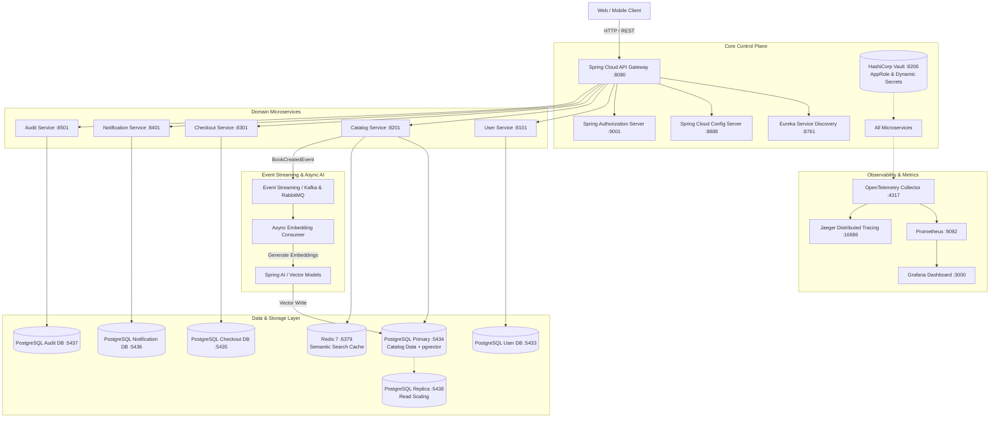

# Bookstore AI Systems (V3)

[](https://openjdk.org/)
[](https://spring.io/projects/spring-boot)
[](https://spring.io/projects/spring-cloud)
[](https://github.com/pgvector/pgvector)
[](https://kafka.apache.org/)
[](https://redis.io/)
[](https://www.vaultproject.io/)
[](https://grafana.com/)

An enterprise-grade, event-driven, RAG-enabled microservices platform architected for high-throughput data processing, vector embeddings in PostgreSQL (`pgvector`), asynchronous message streaming, and agentic AI tool-calling.

---

## 1. Architecture Overview



---

## 2. Key Capabilities & Technical Highlights

- **Event-Driven AI Pipeline:** Decouples heavy AI vector generation from transactional write paths using asynchronous event streaming, dead-letter topics, and consumer idempotency keys.
- **pgvector & Semantic RAG:** Native vector embeddings stored alongside relational catalog entities in PostgreSQL, indexed via HNSW / IVFFlat for sub-50ms cosine similarity searches.
- **Semantic Caching with Redis:** Reduces LLM token costs and accelerates frequent semantic queries by caching query vector embeddings and search results.
- **Structured LLM Outputs:** Enforces strict JSON Schema contracts using Spring AI's structured output converters to guarantee deterministic integration with downstream microservices.
- **Agentic Tool Calling:** Context-aware `BookAssistant` capable of orchestrating multi-step backend actions (e.g., checking stock, managing cart, invoking checkout) with permission guards.
- **Enterprise Observability:** Full distributed tracing (OpenTelemetry/Jaeger) and custom Prometheus metrics tracking LLM token burn, vector query latency, and cache hit ratios.
- **Zero-Trust Secrets Management:** Dynamic database credentials and TLS certificates provisioned automatically via HashiCorp Vault with AppRole authentication.

---

## 3. Microservice & Port Matrix

| Service | Container / Direct Port | Gateway Route | Purpose |
| :--- | :--- | :--- | :--- |
| **API Gateway** | `8080` | `/*` | Edge routing, JWT validation, rate limiting |
| **Discovery Service** | `8761` | `/eureka/**` | Spring Cloud Netflix Eureka service registry |
| **Config Server** | `8888` | — | Centralized Spring Cloud Configuration |
| **Auth Server** | `9001` | `/auth/**` | OAuth2 / OIDC token issuance & user login |
| **User Service** | `8101` | `/api/v1/users/**` | User management and profile lifecycle |
| **Catalog Service** | `8201` | `/api/v1/books/**` | Catalog, inventory, and vector semantic search |
| **Checkout Service** | `8301` | `/api/v1/orders/**` | Cart management, order processing, payments |
| **Notification Service** | `8401` | — | Asynchronous customer email/SMS notifications |
| **Audit Service** | `8501` | — | Immutable audit logging of critical business events |
| **HashiCorp Vault** | `8206` | — | Dynamic secrets & AppRole credential manager |
| **PostgreSQL (Catalog Primary)** | `5434` | — | Relational book data + `pgvector` store |
| **PostgreSQL (Catalog Replica)** | `5438` | — | Read-replica for high-throughput catalog queries |
| **Redis** | `6379` | — | Semantic search cache & distributed rate limiting |
| **RabbitMQ / Kafka** | `5672` (UI: `15672`) | — | Message broker & event streaming |
| **Prometheus** | `9092` | — | Metric aggregation & AI latency tracking |
| **Grafana** | `3000` | — | Production monitoring & AI dashboards (`admin/admin`) |

---

## 4. Quickstart Guide

### Prerequisites
- Docker & Docker Compose v2+
- Java 21 or Java 25 (GraalVM recommended)
- Maven 3.8+

### 1. Bootstrapping the Cluster
The infrastructure automatically generates self-signed certificates and initializes HashiCorp Vault AppRoles via container lifecycle hooks:

```bash
# Start all microservices, databases, and monitoring
docker compose up -d

# Verify all containers are healthy
docker compose ps
```

### 2. Run the Baseline Smoke Test
Validate that all discovery endpoints, gateway routing, and microservice health checks are responsive:

```powershell
# PowerShell (Windows)
powershell -ExecutionPolicy Bypass -File scripts/baseline-smoke-test.ps1
```
```bash
# Bash (Linux/macOS)
./scripts/baseline-smoke-test.sh
```

---

## 5. Interactive Dashboards & APIs

- **Eureka Registry:** [http://localhost:8761](http://localhost:8761)
- **API Gateway Health:** [http://localhost:8080/actuator/health](http://localhost:8080/actuator/health)
- **Catalog Service Swagger:** [http://localhost:8201/swagger-ui/index.html](http://localhost:8201/swagger-ui/index.html)
- **User Service Swagger:** [http://localhost:8101/swagger-ui/index.html](http://localhost:8101/swagger-ui/index.html)
- **Checkout Service Swagger:** [http://localhost:8301/swagger-ui/index.html](http://localhost:8301/swagger-ui/index.html)
- **RabbitMQ Management UI:** [http://localhost:15672](http://localhost:15672) (`guest` / `guest`)
- **Grafana Metrics Dashboard:** [http://localhost:3000](http://localhost:3000) (`admin` / `admin`)
- **Prometheus Metrics:** [http://localhost:9092](http://localhost:9092)

---

## 6. Architecture Rules & Governance

All new code, schema additions, and AI integrations must adhere to the engineering guidelines codified in [CLAUDE.md](file:///c:/projects/showcase/bookstore-ai-systems/CLAUDE.md):
- **Clean DTO Isolation:** JPA entities are never exposed in API signatures.
- **Zero N+1 Queries:** Enforce `JOIN FETCH` and `@EntityGraph`; read paths must use `@Transactional(readOnly = true)`.
- **Flyway Migrations:** All schema changes must be versioned under `src/main/resources/db/migration`.
- **Consumer Resilience:** Idempotency keys and dead-letter topics are required on all event handlers.

